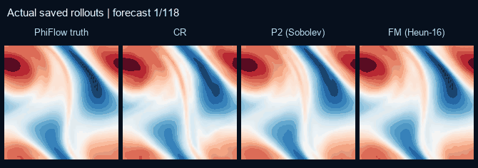
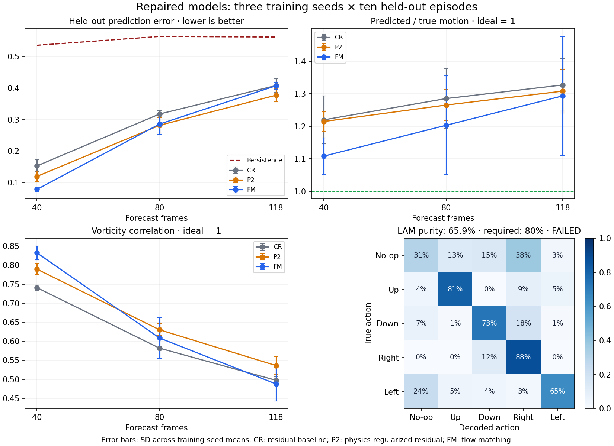
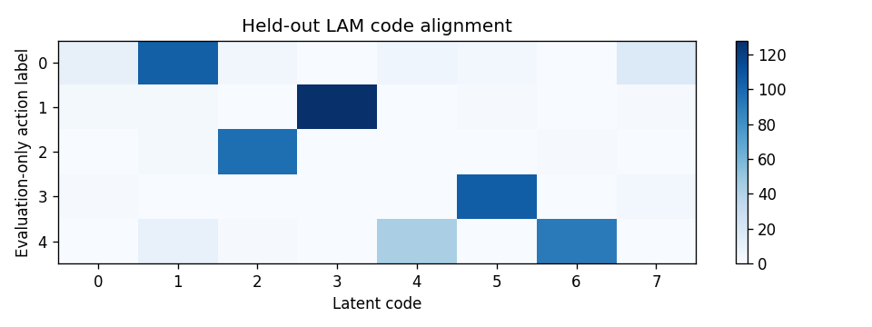
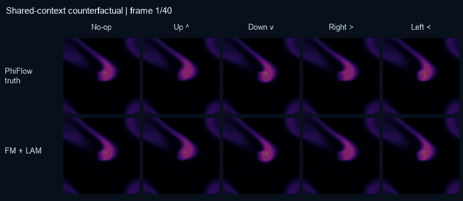
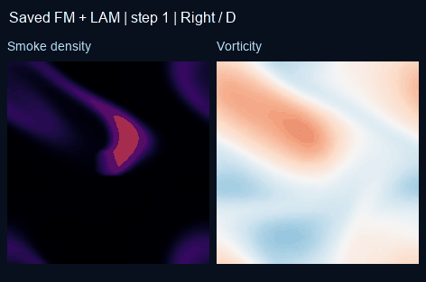
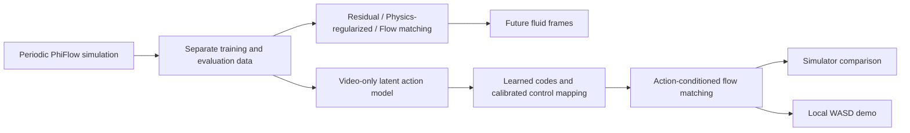

# FluidGenie

[](https://github.com/google/jax)
[](https://github.com/google/flax)
[](pyproject.toml)
[](https://github.com/PrayYoung/FluidGenie/actions/workflows/cpu.yml)
[](LICENSE)

FluidGenie is a Genie-inspired neural world model for simulated 2D fluid motion, built with JAX and Flax. It explores how to forecast moving fluids over many future frames. It also learns hidden controls from unlabeled videos, then lets you steer the learned fluid with WASD keys.

## 1. Forecasting turbulent fluid motion

Given two frames, can a neural model predict how the flow will evolve? We compare three approaches:

- **Residual U-Net (CR):** predicts the change from the current fluid state to the next.
- **Physics-regularized residual (P2):** adds a spatial-gradient loss to the residual model, encouraging the prediction to preserve local flow structure.
- **Flow matching (FM):** learns a continuous transformation from noise to the next fluid state, sampled with a 16-step Heun numerical solver.


*Watch the same vortices evolve in the simulator on the left and in three learned forecasts on the right. Colors show clockwise and counterclockwise rotation.*



Three independent training seeds, each evaluated on the same ten unseen episodes. **State error (MSE)** measures numerical prediction error; lower is better. **Swirl correlation** measures agreement in vorticity, the local rotation of the fluid; higher is better. Values are mean ± standard deviation across training-seed means.

| Model | Future frames | State error ↓ | Swirl correlation ↑ |
|---|---:|---:|---:|
| CR | 40 | 0.1527 ± 0.0190 | 0.741 ± 0.007 |
| CR | 80 | 0.3174 ± 0.0100 | 0.582 ± 0.003 |
| CR | 118 | 0.4078 ± 0.0212 | 0.497 ± 0.009 |
| P2 | 40 | 0.1195 ± 0.0169 | 0.789 ± 0.015 |
| P2 | 80 | 0.2816 ± 0.0248 | 0.630 ± 0.016 |
| P2 | 118 | 0.3771 ± 0.0212 | 0.536 ± 0.024 |
| FM | 40 | 0.0783 ± 0.0060 | 0.832 ± 0.018 |
| FM | 80 | 0.2855 ± 0.0335 | 0.609 ± 0.054 |
| FM | 118 | 0.4071 ± 0.0119 | 0.488 ± 0.044 |

FM leads at 40 frames and has the lowest divergence error—our measure of deviation from incompressible flow—at all three horizons. P2 has the lowest average state error at 80 and 118 frames and preserves swirl patterns better at those longer horizons.

## 2. Discovering controls without labels and steering fluid live

The control model learns from videos of fluid pushed by a hidden joystick. Its three-step loop is:

1. **Encode motion.** A video-only Latent Action Model (LAM) compares frame-to-frame changes and compresses them into eight discrete codes.
2. **Identify controls.** After learning, training labels map the codes to no-op, up, down, right and left. This frozen mapping reaches **94.44% calibrated purity** on held-out transitions; labels are used for naming and evaluation, not LAM training.
3. **Steer the forecast.** An action-conditioned flow-matching model takes the selected code and predicts the next fluid frame, enabling a local WASD demo.


*The alignment plot shows which learned motion codes correspond to the five joystick actions.*


*Start from the same fluid state and try five controls. The top row follows the simulator; the bottom row follows the learned model.*


*Right, up, left, then down: a real saved-model rollout, with smoke density and swirling motion shown side by side.*

The steering evaluation covers five simulator seeds, all five controls, and 40 predicted frames per control. Steering ± is standard deviation across five episode means.

| Measure | Plain-English meaning | Result |
|---|---|---:|
| Calibrated purity | Codes matching calibrated labels | 94.44% |
| Active codes | Discrete motion codes used | 8 / 8 |
| Local direction cosine | Agreement with simulator response | 0.840 ± 0.084 |
| Vorticity correlation | Similarity of swirling motion | 0.837 ± 0.075 |
| Density correlation | Similarity of smoke fields | 0.742 ± 0.038 |
| Physical-state MSE | Numerical fluid prediction error | 0.121 ± 0.070 |

## Architecture and repository map



```text
fluidgenie/  Simulation, models, training, evaluation and demo
configs/     Model and data settings
scripts/     Dataset generation, experiments and visual exports
tests/       CPU regression checks
research/    Final verified reports and numerical evidence
```

## Quickstart

Install dependencies and run the CPU tests:

```bash
uv sync --group dev
JAX_PLATFORMS=cpu uv run pytest -q
```

Generate a tiny dataset in an empty directory, then run two CPU training steps. This checks the end-to-end pipeline; it does not reproduce the published benchmark.

```bash
JAX_PLATFORMS=cpu uv run python scripts/generate_disjoint_data.py \
  --out data/quickstart --resolution 16 --steps 8 --burn-in 4 \
  --train-episodes 2 --heldout-episodes 1

JAX_PLATFORMS=cpu uv run python -m fluidgenie.training.train_continuous_residual \
  --data data/quickstart/train --stats data/quickstart/train_stats.npz \
  --out outputs/quickstart --steps 2 --batch 1 --hidden-dims 8 16 16 \
  --num-res-blocks 1 --grain-workers 0 --warmup-steps 0 \
  --checkpoint-every 2 --log-every 1 --tb 0
```

The interactive steering demo requires the trained, action-conditioned checkpoint and its original local data. **Trained weights and datasets are not stored in Git.** If you have the retained artifacts, run:

```bash
uv run python -m fluidgenie.cli.steering_demo \
  --checkpoint outputs/lam_v6/action_fm/latest \
  --episode data/lam_v5/joystick/heldout/episode_000000.npy \
  --stats data/lam_v5/joystick/train_stats.npz
```

Open the printed localhost URL. Use WASD or arrow keys to steer, Space for no-op, and reset to return to the initial state.

<details>
<summary>Methodology, caveats and full reports</summary>

**Forecasting.** The published autonomous-flow comparison uses 64×64 simulations, three training seeds and ten shared held-out episodes. MSE averages horizontal velocity, vertical velocity and smoke density in physical units. A persistence baseline (repeat the last observed state) scores 0.5358 / 0.5637 / 0.5619 at 40 / 80 / 118 frames. FM trained for 15,000 steps versus 3,000 for CR/P2 and uses 16 solver steps at inference, so compute is not matched. Long-horizon motion/energy drift and declining vorticity correlation remain unresolved; these results do not establish indefinite turbulent-flow fidelity or universal superiority.

**Learning and evaluating controls.** The reported LAM run uses 60 training and ten held-out episodes, with 630 held-out transitions. Its NMI is 0.7920 and shuffled/real reconstruction-error ratio is 8.01×. One LAM/FM training pair was evaluated, and the development held-out set has already informed debugging; there is no fresh untouched final-test confirmation. The architecture revision combines difference inputs, spatial-position placement and final normalization, so it does not isolate a single causal mechanism. The external “92.3% Phase-8” comparison was not independently verified.

**Steering protocol and limits.** Five fixed simulator seeds (200003–200007), five held-action branches each, 40 forecast frames, 16 Heun solver steps, and fixed model-noise seed 12345. Initialization, projection, burn-in and the no-op prefix run once per seed; branches fork the exact velocity/density/pressure state. Exact array equality passes with maximum prefix difference 0.0, resolving the original 1.49e-6 context mismatch without loosening tolerance. Response cosine compares action-minus-no-op velocity fields, with a central-jet weighting; no-op is excluded because its response is zero. Field correlations include all five actions. Density correlation measures absolute fields, not an isolated action effect. Positive whole-rollout correlations coexist with visible final-density drift. Training holds are 2–4 frames; the 40-frame held controls and 16-frame square commands test longer holds. A square command sequence does not prove a square fluid trajectory.

**Visuals.** All GIFs use actual saved simulator/model arrays, fixed shared scales, and index-selected cases; each is below 2.5 MB. The autonomous GIF uses training seed 0, held-out episode 0, and clips colors at the truth's 99th-percentile absolute vorticity. The counterfactual GIF uses seed 200003 and a shared density range from zero to the joint truth/prediction maximum. Negative density predictions are clipped only for display; metrics use original arrays. Vertical orientation is +y upward. [Rendering provenance](assets/visuals_manifest.json) records source hashes and frame selection.

**Historical scope and cleanup.** Early episode-0..12 evaluations overlapped training data and used different protocols; they are not unseen-data or matched controls. Earlier uniform joystick controls also differ from the current localized jets. Superseded engineering dumps, plans and provider-specific legacy launch scripts were removed from the current checkout; final continuous-flow and steering evidence is retained. The [frozen steering protocol](research/results/lam_v6/evaluation_protocol.json) preserves the original evaluation design, while the retained reports carry the historical disclosures and verification record. Personal data, credentials, provider configuration, raw datasets and large weights remain excluded from Git.

**Reports and evidence**

- [Training and latent-action discovery](research/lam_v6_results.md)
- [Five-seed steering report](research/steering_evaluation_results.md)
- [Earlier negative-result diagnosis](research/lam_v5_diagnosis.md)
- [Forecast metrics](research/results/repair_v4/completed_campaign/results_summary.json) and [saved forecast comparison](research/results/repair_v4/completed_campaign/recorded_rollout_comparison.png)
- [Steering metrics](research/results/lam_v6/counterfactual_summary.json), [LAM certificate](research/results/lam_v6/lam_discovery.json), [training outcome and original failure](research/results/lam_v6/outcome.json)
- [Frozen steering protocol](research/results/lam_v6/evaluation_protocol.json)
- [Checkpoint/source hashes](research/results/lam_v6/steering_provenance.json) and [CPU/media validation](research/results/lam_v6/steering_validation.json)

To reproduce the steering measurements and visuals with the retained local artifacts:

```bash
uv run python scripts/benchmark_counterfactual_steering.py \
  --checkpoint outputs/lam_v6/action_fm/latest \
  --stats data/lam_v5/joystick/train_stats.npz \
  --data data/lam_v5/joystick/train --out outputs/lam_v6/counterfactual \
  --seeds 200003 200004 200005 200006 200007

uv run python scripts/export_steering_showcase.py \
  --checkpoint outputs/lam_v6/action_fm/latest \
  --episode data/lam_v5/joystick/heldout/episode_000000.npy \
  --stats data/lam_v5/joystick/train_stats.npz \
  --out assets/square_steering.gif --hold 16 \
  --arrays-out outputs/lam_v6/square_steering_arrays.npz

uv run python scripts/build_readme_visuals.py
```

</details>
