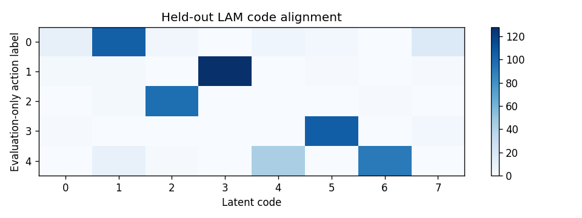

# LAM v6 training results and evaluation follow-up

Architecture version 4 passed the unchanged version-4 discovery certificate on the reused ten held-out joystick episodes (630 transitions). LAM completed 8000 steps and action-conditioned flow matching completed 15000 steps. All 91 GPU regressions passed. This establishes latent-action discovery on the development held-out split. The subsequent shared-state CPU evaluation and real-data showcase are now complete; see the [follow-up steering report](steering_evaluation_results.md).

| Metric | LAM v5 | LAM v6 |
|---|---:|---:|
| Calibrated held-out purity | 46.03% | 94.44% |
| NMI | 0.2702 | 0.7920 |
| Active codes | 8 | 8 |
| Shuffled / real reconstruction error | 2.177 | 8.006 |
| Distinct five-action calibration gate | Fail | Pass |
| Frozen discovery gate | Fail | Pass |

The v5-to-v6 purity change is +48.41 percentage points. The 60/10 data split and training-only statistics were reused byte for byte. The code version deployed by the successful training job matches the published source hashes. Raw certificates, per-transition labels/codes and training metrics are in [`results/lam_v6`](results/lam_v6/).

## Original campaign blocker (resolved in follow-up)

The later counterfactual simulator evaluation failed before producing a complete benchmark. Independently regenerated action branches did not satisfy its pre-action context equality check: maximum reported absolute difference was 1.4901161e-6, against atol=1e-6 and rtol=1e-7. The command therefore exited with a workload failure despite both training stages succeeding. Showcase export was not reached.

Do not treat this as established steering correctness, or silently weaken the equality test. The completed follow-up forks one exact simulator state and reuses the trained checkpoints. It does not repeat LAM, conditioned FM, or the completed CR/P2/FM baselines. All five fixed CPU seeds completed, with shared-prefix difference 0.0; no follow-up GPU job was allocated. The original failed campaign remains in the outcome record. Quantitative agreement and remaining physical drift are reported separately in the [steering results](steering_evaluation_results.md).

## Validation and limits

All 76 delivered files were verified against the download manifest. The compact bundle was 199.60 MiB and contained no new dataset copy. The Pod was automatically terminated after retrieval. Checkpoints remain local; numerical/visual evidence is published without provider setup, personal information, credentials, raw datasets, or large model weights.

One LAM seed was trained. The held-out split has already informed development and is not a fresh final test. The combined architecture revision does not isolate the contributions of difference inputs, positional placement, or final normalization. Latent purity and completed conditioned training are prerequisites, not evidence that neural rollouts reproduce the simulator's counterfactual response.
